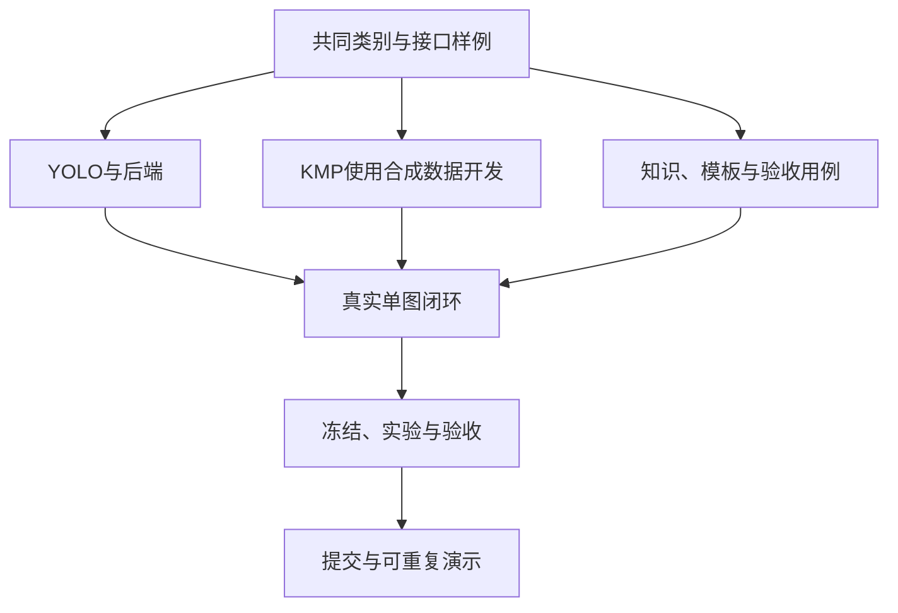

# Roadmap

目标：在Android App中完成“选图/拍照、输入批次 → YOLO六类缺陷检测 → 知识辅助问答与复检建议 → 人工确认 → 历史记录与报告”的可演示流程。

状态：所有里程碑初始为计划中。本表是2026年10月30日起的内部安排；实际赛事与校内截止须核对最新要求。日期是目标，验收结果决定是否完成。

## 1. 交付范围

首轮交付Android App、本地工位后端、NEU-DET六类YOLO模型、一个云端大模型API、审核知识、人工复核和报告。先完成单图闭环，再增加批量。魔搭等托管方式按实际资源验证后启用，并说明推理部署位置。

后续范围：桌面端、语音、更多产品和工单、同域正常样本、真实工位验证。它们不阻塞首轮闭环；手机内部离线YOLO和任意工业零件通用检测不属于首轮承诺。

## 2. 里程碑与退出条件

| 里程碑 | 目标日期 | 主要工作 | 可验收交付 | 退出条件 |
|---|---|---|---|---|
| M0 共同约定 | 10月30—31日 | 数据检查、类别/接口/页面、范围和通知核对 | 划分方法、接口样例、页面线框、验收表 | 三方向可依同一份约定开始工作；数据与接口关键问题有结论 |
| M1 各方向首个版本 | 11月1—3日 | YOLO基线与单图API；App样例页面；知识与报告模板 | 首个权重/结果、可安装样例App、首批知识与模板 | 模型能推理，App不用等待训练即可走通样例，模板可被后端读取 |
| M2 真实闭环 | 11月4—6日 | 真实检测、API、WebSocket、问答、复核与持久化 | 一条真实调用闭环及对应记录 | App上传到报告导出可重复完成；原预测和人工修改可追溯 |
| M3 冻结与验收 | 11月7—8日 | 模型评价、流程/断线检查、大模型对照 | 冻结版本、指标、用例结果、失败分析、成本 | 阻断性问题处理；目标与实测分开；结果对应同一版本 |
| M4 首次提交 | 11月9日争取完成 | 三人核对、演示、材料检查 | 安装包、启动说明、计划书/PPT/视频、提交记录 | 按实际赛事要求完成首次上传；保留可重复演示环境 |
| M5 截止前复查 | 11月10日前按通知 | 复核上传、修正必要问题 | 最终文件与版本清单 | 提交状态确认；不以未经验证的新功能替换已验证版本 |
| M6 晋级完善 | 晋级安排确认后 | 多种子实验、用户测试、同域正常与工位数据 | 扩展实验与试用记录 | 新结论有授权样本和独立验证；遵守材料更新要求 |

## 3. 依赖与并行方式

后端先交合成响应和类别映射，再替换为真实结果；App先做状态与坐标，再精修界面；文档方向先提供知识和模板，再组织实验。任何一方发现字段或状态不一致，当天同步共同接口文档。

## 4. 首轮验收原则

- 检测结果、人工确认和AI建议分别保存；未检出显示“未检出六类目标缺陷”。
- 模型精度报告mAP@0.5、mAP@0.5:0.95、六类AP、固定阈值P/R及失败图片。mAP@0.5≥0.75为初步目标，不是已达结果。
- 本地batch=1、固定设备和输入分辨率下，处理P95≤500毫秒为初步目标；真实计时需披露预处理/推理/后处理范围。
- 大模型与固定模板比较复检/报告耗时、修订量、事实和引用正确性。约30%时间改善只是待验证目标。
- 工位模式区分外网中断与局域网不可达；托管模式不能宣称离线检测可用。
- 正式材料、演示、模型、服务与App版本一致，真实结果与合成样例清楚区分。

详细用例见[联调与验收](plans/05-integration-acceptance.md)。

## 5. 降级与变更

若M1模型不稳定，优先修数据与基线；保留单图、一个API和简单检索，暂缓新算法。若API失败，保留检测与人工记录，明确固定模板/待补生成状态。若M2未闭环，暂停批量、托管、语音和其他端，三人共同解决联调。

M2之后只接受有明确验收、工作量和依赖评估的范围变更。M3冻结后优先修复；影响数据划分、模型阈值、坐标或统计的修改须重新评价受影响结果。不得为满足目标改写实测值。
